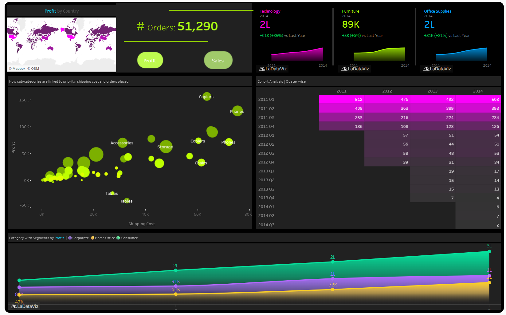
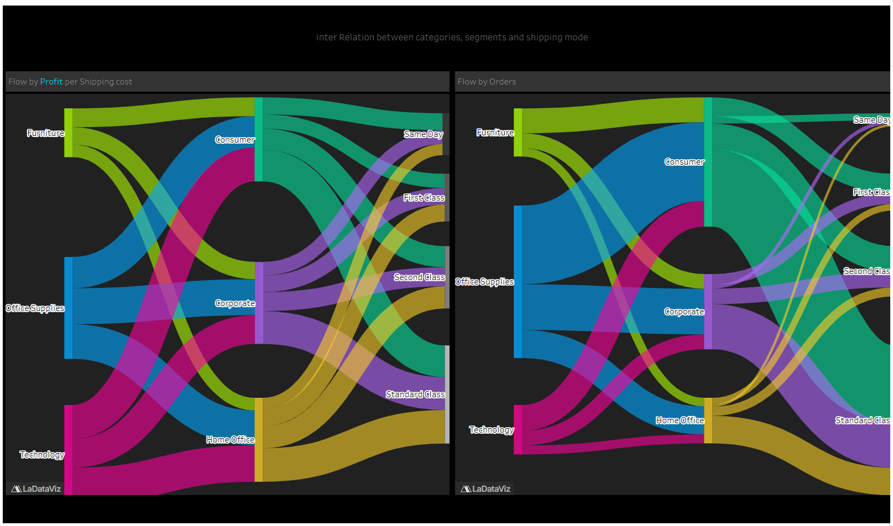

# Global Superstore | Performance, Cohort & Shipping Flow Analytics

> **Business Analyst portfolio project:** a two-dashboard interactive Tableau Story examining global commercial performance, customer cohorts and operational relationships across categories, customer segments and shipping modes.

[**▶ Explore the live Tableau Story**](https://public.tableau.com/views/GlobalSuper_store_black_theme_new/Story1) &nbsp; | &nbsp; [**📥 Access the source Excel dataset**](GlobalSuperstore.xls) &nbsp; | &nbsp; [**📄 View the one-page portfolio showcase**](Global-Superstore-Portfolio-Showcase.pdf)

## Project at a glance

| Dimension | Scope |
| --- | --- |
| Business context | Global Superstore retail orders and performance |
| Period illustrated | 2011–2014 |
| Data | `GlobalSuperstore.xls` (provided workbook; original name `GlobalSuperstore(3).xls`) |
| Tools | Tableau Public, Microsoft Excel |
| Analysis | KPI tracking, prior-year comparisons, country filtering, priority/volume vs shipping cost, customer cohorts, segment trends, Sankey flow analysis |
| Deliverables | Tableau Story, two dashboard screenshots, original workbook, one-page PDF portfolio showcase |

## The business problem

How can management monitor **where revenue and profit are generated**, examine the relationship between **shipping cost, order volume and priority**, understand **customer activity across acquisition cohorts**, and explore **category–segment–shipping mode dependencies** within a single interactive story?

I structured the analysis into two complementary dashboards: first identifying performance and behavior, then visualizing the paths through which orders and business metrics move.

## Dashboard 01 — Global Performance and Customer Cohorts



**Objective:** combine executive-level retail KPIs with drill-down views of profitability, shipping cost, customer activity and segment performance.

| Analytical component | What I built | Decision-support use |
| --- | --- | --- |
| Category KPI cards | Sales/profit views for **Technology, Furniture, Office Supplies**, with 2014 values and comparison to the prior year | Monitor category performance and direction of change |
| Four-year trend sparklines | Compact trend charts across **2011–2014** for the three business categories | Spot longer-term movement rather than reading a single-year KPI |
| Country-level map and filter | Profit by country; the story supports country-level exploration | Compare metrics and chart behavior within selected national markets |
| Shipping-cost scatterplot | Profit or Sales versus shipping cost; color encodes Order Priority and bubble size represents subcategory order volume | Examine relationships among freight expense, commercial outcomes, priority and order volume |
| Quarterly customer-cohort matrix | Groups customers by their first-acquisition quarter and displays their activity in subsequent quarters | Examine patterns of returning customer activity over time |
| Segment trend chart | 2011–2014 line/area visual for customer segments and category-related sales/profit | Compare segment contributions and how they evolve |

**How to explore:** open the live Story, select a country on the map to focus market-level analysis, then review KPI/category changes, scatterplot patterns, customer cohorts and segment trends. Toggle available Sales/Profit controls where relevant.

> **Metric note:** the cohort view shows quarter-level values. Interpretation as a *retention rate* requires an explicit numerator/denominator definition; the screenshot alone does not establish a retention percentage. Likewise, scatterplot associations are exploratory and are not evidence of causation.

## Dashboard 02 — Category, Segment & Shipping-Mode Relationships



**Objective:** reveal how categories, customer segments and fulfillment choices relate through two Sankey diagrams.

**Left Sankey — Commercial measure relative to shipping cost.** Depicts flows across **Category → Segment → Shipping Mode** using the Tableau model for Profit/Sales relative to shipping cost. This highlights areas of concentration and supports hypotheses about logistical efficiency and commercial contribution. The precise flow metric is defined by the underlying Tableau calculation.

**Right Sankey — Order volume.** Depicts **order counts** through the same three dimensions, making it possible to compare operational volume mix against financial patterns.

**How to explore:** follow each stream from product category through the customer segment to shipping mode. Contrast larger order streams with the financial-measure view to identify potential areas for deeper investigation.

## Methods & implementation

1. Worked from the Global Superstore Excel workbook and connected the data to Tableau.
2. Created category-level indicators, prior-year comparisons and multi-year trend views.
3. Combined a geographic filter, profitability/shipping-cost scatterplot, acquisition cohorts and time-based segment chart into an executive dashboard.
4. Built two Sankey flow views to compare financial/shipping relationships against order volumes across Category, Segment and Shipping Mode.
5. Organized the two dashboards into a Tableau Story to move from performance monitoring to drivers and operational pathways.

### Business Analyst capabilities demonstrated

- Business question framing and analytical storytelling
- KPI design; YoY performance tracking; categorical and geographic comparisons
- Customer acquisition-cohort reporting
- Multidimensional segmentation and exploratory visual analysis
- Shipping cost / order priority / profitability investigation
- Sankey-based operations and order-flow visualization
- Tableau interactivity and dashboard UX
- Portfolio documentation and stakeholder communication

## Evidence-based observations and limits

- The dashboard screenshot displays **51,290 orders** in its overall Orders indicator; other values can change based on the workbook's filters and selected metrics.
- The displayed dashboard covers **2011–2014**, including category year-over-year labels and four-year trend panels.
- The project demonstrates analytical views and interactions. It does **not** claim realized cost reductions, revenue gains, causal effects, forecast accuracy or deployment to production.
- Interpret 'profit/sales per shipping cost' according to the specific Tableau calculation. The exported screenshots alone do not establish the exact numerator and denominator.
- The Excel workbook is the raw/source dataset. Screenshots are static representations; for interactive exploration use the Tableau Story link.

## Repository contents

```text
Global-Superstore-Tableau-Story-Analytics/
├── README.md
├── GlobalSuperstore.xls
├── Dashboard-1-Global-Performance.png
├── Dashboard-2-Category-Segment-Shipping-Flow.png
├── Global-Superstore-Portfolio-Showcase.pdf
└── Editable-Portfolio-Showcase.pptx
```

## Explore or reproduce

1. **View the interactive Story:** https://public.tableau.com/views/GlobalSuper_store_black_theme_new/Story1
2. **Download the workbook:** [GlobalSuperstore.xls](GlobalSuperstore.xls) or directly from the file in this repository.
3. **Review both dashboard images:** open the two PNG previews in the repository.
4. **Review the methods and limitations:** read the sections above.
5. **Edit the showcase links if required:** open `Editable-Portfolio-Showcase.pptx` in PowerPoint, select each CTA button, choose **Link / Edit Link**, replace the target URLs, and **Export → PDF**. For publication, use the actual public repo URL and dataset URL.

**Source notes:** dashboard descriptions reflect the supplied Tableau Story visuals and the creator's description. This repository supplies the source Excel data but does not contain a Tableau workbook (.twb/.twbx) or automated validation logs.
